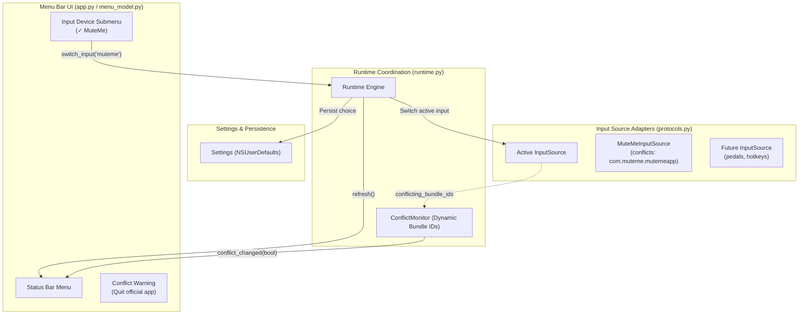

# Technical Specification: Configurable Input Sources & Dynamic Conflict Monitoring

## 1. Overview & Goals

Following the introduction of pluggable dictation backends and feedback sinks in Milestone 7, this specification establishes support for **configurable hardware input sources** in MuteMe Flow.

While MuteMe is currently the primary supported physical device, the system architecture must allow users to select their active input device from the menu bar, with seamless switching at runtime. Furthermore, hardware-specific application conflict checks (such as detecting the official MuteMe desktop application) must be bound dynamically to the active input source rather than running globally.

---

## 2. Key Requirements

1. **User Settings & Persistence:**
   - Add `input_source: str` setting (default: `"muteme"`), persisted in `NSUserDefaults` under key `"inputSource"`.
   - Maintain a registry of input choices: `INPUT_DISPLAY_NAMES = {"muteme": "MuteMe"}`.
   - Support safe fallback if an unrecognized string is found in defaults.

2. **Protocol Extension (`InputSource`):**
   - Add properties `conflicting_bundle_ids: frozenset[str]` and `conflicting_app_names: frozenset[str]` to the `InputSource` protocol.
   - `MuteMeInputSource` declares `conflicting_bundle_ids = OFFICIAL_APP_BUNDLE_IDS` and `conflicting_app_names = OFFICIAL_APP_NAMES` (`{"MuteMe", "MuteMe-Client"}`). Because official MuteMe apps lack confirmed bundle IDs on macOS, matching falls back gracefully to process names.
   - Future input sources (pedals, keyboards, etc.) can declare their own vendor conflicts or return empty `frozenset()`.
   - Declare optional power management hooks `pause(self) -> None` and `resume(self) -> None` for clean system sleep/wake transitions.

3. **Dynamic Conflict Monitoring:**
   - Update `ConflictMonitor` to accept dynamic updates to its target bundle IDs and process names via `set_conflicts(bundle_ids: frozenset[str], app_names: frozenset[str])`.
   - When target sets are empty (e.g. switching away from MuteMe to a non-conflicting input), `ConflictMonitor` clears any active conflict flag, short-circuits process scans, and invokes the change callback so the warning row in the menu disappears immediately.

4. **Runtime & Controller Input Lifecycle:**
   - Decouple `Runtime` so the active `InputSource` is managed dynamically.
   - `Runtime.switch_input(choice: str) -> None`:
     - If the state machine is currently recording, cleanly stop dictation on the active backend.
     - Stop/release the previous input source (shutting down worker threads and releasing USB/hardware handles).
     - Instantiate and start the new input source.
     - Re-wire the input event handler to the controller.
     - Update `ConflictMonitor` with the newly active input's `conflicting_bundle_ids`.
     - Trigger UI refresh.

5. **Menu Bar UI & Settings:**
   - Add an **"Input Device"** submenu in the menu bar:
     - Contains selectable rows for available inputs (`MuteMe` initially).
     - Displays checkmark `✓` on the currently active input.
   - Update the conflict row (`Quit the official MuteMe app?`):
     - Only shown if the *currently active* input has conflicting apps running.
   - Informational status reflects the active input (e.g., `Input: MuteMe (connected)` or `Input: MuteMe (disconnected)`).

---

## 3. Architecture & Data Flow

---

## 4. Stack Breakdown (Stacked PRs on top of PR #29)

To maintain focused, atomic, and thoroughly reviewable changes (following the stacked PR workflow):

- **Branch 1: `feat/m8-1-input-protocols-conflicts`**
  - Extend `InputSource` protocol with `conflicting_bundle_ids: frozenset[str]`.
  - Update `MuteMeInputSource` to expose `OFFICIAL_BUNDLE_IDS`.
  - Make `ConflictMonitor` dynamically configurable with `set_conflicting_bundle_ids(...)`.
  - Unit tests for protocol adherence and dynamic conflict monitoring.

- **Branch 2: `feat/m8-2-runtime-input-switching`**
  - Add `input_source` to `Settings`, `UserDefaultsStore`, and `INPUT_DISPLAY_NAMES`.
  - Update `Runtime` to support dynamic input creation and `switch_input(...)`.
  - Unit tests for input switching, state machine cleanup on switch, and settings persistence.

- **Branch 3: `feat/m8-3-ui-input-menu`**
  - Add "Input Device" submenu to `MuteMeFlowApp` in `app.py`.
  - Connect UI actions to `runtime.switch_input(...)`.
  - Ensure conflict warning row dynamically respects the active input.
  - Contract and integration tests for menu model, row states, and UI interactions.
