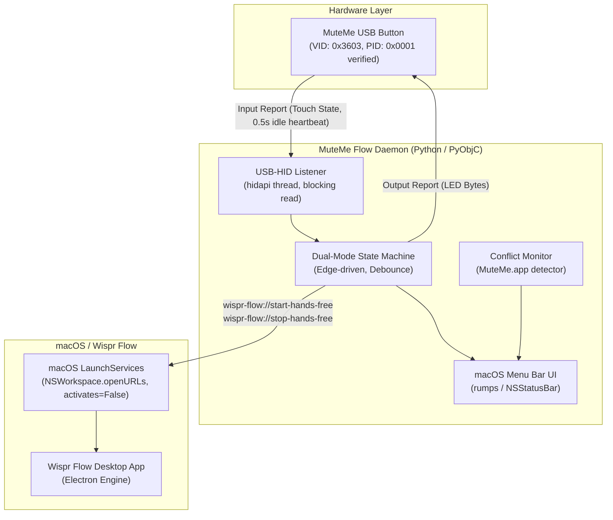
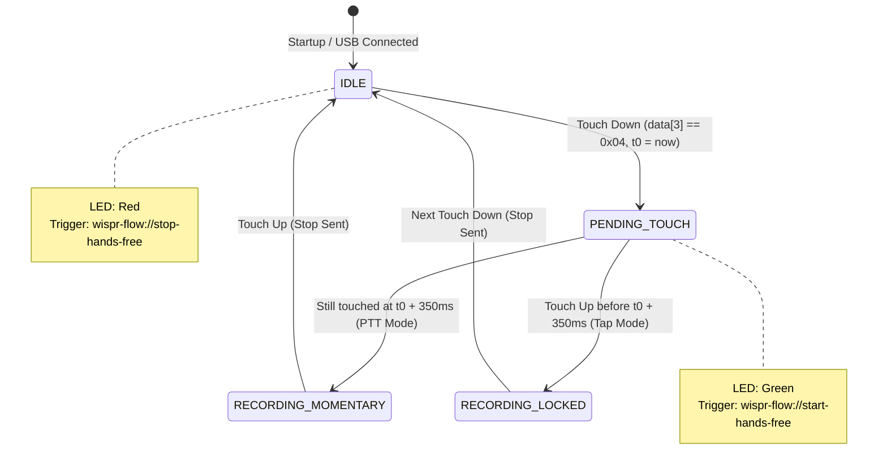

# Technical Specification: MuteMe Flow (macOS)

## 1. Executive Summary

**MuteMe Flow** is an open-source (MIT-licensed), lightweight macOS menu bar utility that bridges physical **MuteMe** USB hardware buttons with the **Wispr Flow** AI dictation platform. The MuteMe Original is verified on hardware; Mini and legacy variants are best-effort (see section 3.1).

It provides best-effort visual LED feedback (Red for Idle, Green for Dictating; see section 4.3 for when it can drift from Wispr's real state) and supports both **Push-to-Talk (Hold-to-Speak)** and **Tap-to-Toggle (Hands-Free)** interactions out of the box using Wispr Flow's native URL scheme.

---

## 2. System Architecture & Topology



---

## 3. Hardware Specification (MuteMe USB-HID)

### 3.1 Device Identifiers
Devices are matched against an explicit list of `(VID, PID)` pairs, never a VID × PID cross-product.

| VID | PID | Model | Status |
| :--- | :--- | :--- | :--- |
| `0x3603` | `0x0001` | MuteMe Original (current generation) | **Verified** on hardware (HID usage page 9, usage 6; 8-byte input, 1-byte output report) |
| `0x3603` | `0x0002` / `0x0003` / `0x0004` | MuteMe Mini variants | Unverified, no hardware available |
| `0x20A0` | `0x42DA` / `0x42DB` | Legacy Original / Mini | Unverified, no hardware available |

Unverified pairs ship enabled but are flagged in the README until confirmed by a tester.

### 3.2 USB HID Reports
* **Input Report (Button Touch State):**
  * Read with a blocking `d.read(64, timeout_ms)` on a dedicated thread. Returns an 8-byte buffer; only `data[3]` is meaningful.
  * `data[3]` values (verified on 0x3603:0x0001):

    | Value | Meaning | Frequency |
    | :--- | :--- | :--- |
    | `0x04` | Touch begins | Once per touch |
    | `0x01` | Touch held | ~70 Hz (~14 ms) while touched |
    | `0x02` | Touch ends | Once per touch |
    | `0x00` | Idle | Heartbeat every ~0.5 s while idle |

  * A quick tap measured 123 ms (`0x04` to `0x00`); a deliberate hold measured 1.465 s.
  * **The state machine is edge-driven.** Down is `0x04`; up is `0x02`, or the first `0x00` after a non-zero value if `0x02` is missed. `0x00` alone is never a release because it is also the idle heartbeat.
  * **Watchdog:** no report of any kind for ~1.5 s means the device is gone (see hotplug target in section 8).
* **Output Report (LED Control Sequence):**
  * Transmitted via USB HID Output Report: `d.write(bytes([0x00, COLOR_CODE]))`. The leading `0x00` is the report ID that hidapi requires on macOS; the report payload itself is 1 byte.
  * **Constraint:** send exactly 2 bytes. A 3-byte write was accepted without error on hardware, so padding is not known to fault the device, but it is unspecified and must not be relied on.
  * `0x00`: Off
  * `0x01`: **Red** (Idle / Standby)
  * `0x02`: **Green** (Dictation active)
  * `0x03`: **Yellow** (Conflict / Warning)
  * `0x04`: **Blue** (Connecting / device found, Wispr Flow not running)

---

## 4. Interaction & State Machine Specification

The state machine implements **Dual-Mode Operation**. It is driven by touch **edges** (see section 3.2), never by raw report levels:
* **$T_{\text{hold}} = 350\text{ms}$**: a tunable default, stored in `UserDefaults`. The bridge implements hold/tap detection itself, so it does not depend on any Wispr Flow constant. A deliberate quick tap measured 123ms, which leaves comfortable margin.
* **$T_{\text{debounce}} = 30\text{ms}$**: a touch-down within this window of the previous touch-up is ignored. The observed sequences (`4,1…,2,0`) are clean, so this is a conservative default to be tuned during implementation.
* **$T_{\text{latch}} = 0\text{ms}$** by default (see 4.2).



### 4.1 State Definitions
1. **`IDLE`**: Hardware LED is **Red**. Wispr Flow is believed not to be recording.
2. **`PENDING_TOUCH`**: Button is touched. The app immediately dispatches `wispr-flow://start-hands-free` and turns LED **Green**. A one-shot timer fires the transition to `RECORDING_MOMENTARY` at $T_{\text{hold}}$ if the touch is still active; a touch-up first cancels it.
3. **`RECORDING_MOMENTARY` (Push-to-Talk):** User held the button past $T_{\text{hold}}$. Touch-up immediately dispatches `wispr-flow://stop-hands-free` and transitions to `IDLE`.
4. **`RECORDING_LOCKED` (Hands-Free Toggle):** User released before $T_{\text{hold}}$. The recording remains active. The next **touch-down** (not touch-up) dispatches `wispr-flow://stop-hands-free` and returns to `IDLE`; the matching touch-up is ignored.

### 4.2 Wispr Flow Command Semantics (observed on v1.6.1174)
Observed on one machine by firing the URLs through the `open -g` command-line tool, one trial per case, judged by eye and by Wispr's unified-log activity:

| Behaviour | Evidence |
| :--- | :--- |
| `start-hands-free` while already recording is a no-op | Seen directly: nothing changed on screen |
| `stop-hands-free` while idle is a no-op | **Inferred** only: no log activity, nothing seen |
| `stop-hands-free` ~100ms after `start-hands-free` is honoured; Wispr starts and stops cleanly (a visible flicker) with no stuck recording | Seen directly |
| Wispr does not take focus | **Soft**: "I think the window stayed at front" |

**Hard gate before implementation:** the table above was produced with the `open -g` tool, not the `NSWorkspace.openURLs` API (`activates=False`) that section 2 mandates, and from a single trial per case. Implementation does not start until a spike has repeated these cases through the real API and recorded the results here:
1. start while recording, stop while idle, and a stop ~100ms after a start behave as in the table;
2. Wispr does not take focus, checked explicitly against the frontmost application before and after each dispatch;
3. a longer recording still transcribes correctly after a quick start/stop;
4. each case is repeated at least 10 times to rule out one-off results.

If the spike contradicts the table, this section and the state machine are revised before any code is written. Until the spike passes, treat every row above as unconfirmed.

Consequences:
* The originally proposed latch guard is not needed for correctness. The bridge keeps it only as an optional safety margin ($T_{\text{latch}}$, default `0`); if non-zero, a stop within $T_{\text{latch}}$ of the start is delayed by the remainder.
* If the idempotence findings hold, the bridge may re-send the command matching its own state (for example, a stop on every return to `IDLE`) to resync after drift.
* The URL scheme is undocumented. A regression run against the real app is required before each release (section 8).

### 4.3 State Drift
The channel to Wispr is one-way, so the LED reflects **button state**, not Wispr's actual state. Drift happens when Wispr is toggled by its own hotkey, stops on its own (silence or time limit), or is not running. v1 accepts best-effort accuracy and relies on idempotent commands to recover on the next touch. Polling Wispr for real state is out of scope for v1.

### 4.4 Wispr Flow Not Running
Dispatching a `wispr-flow://` URL launches Wispr Flow if it is not running, which would be an unexpected side effect of touching a mute button. Therefore:
* Wispr Flow's presence is tracked via `NSWorkspace.runningApplications` (bundle identifier `com.electron.wispr-flow`, read from the installed app's `Info.plist`) plus launch/terminate notifications.
* While it is not running, **touches are swallowed** (no URL is dispatched) and the LED shows **Blue**.
* When it launches, the LED returns to **Red** (`IDLE`). If it quits while a recording state is active, the state machine returns to `IDLE` and the LED shows Blue.

### 4.5 Lifecycle and Edge Cases
| Situation | Behaviour |
| :--- | :--- |
| Device unplugged during a recording state | Send `stop-hands-free`, return to `IDLE`, show "not connected" in the menu |
| App quits (menu Quit, SIGTERM) while recording | Send `stop-hands-free` before exit, LED to Red. A hard crash cannot guarantee this; the next touch resyncs (section 4.3) |
| Device opened while the finger is already down (a `0x01` with no preceding `0x04`) | Ignore until a `0x00` or `0x02` is seen, then require a fresh `0x04` |
| Touch-down within $T_{\text{debounce}}$ of the previous touch-up | Ignored |
| Missing `0x02` | The first `0x00` after non-zero input is treated as the up edge (section 3.2) |
| System sleep / wake | Close the device on sleep; on wake, re-open, send `stop-hands-free`, set LED to Red |

### 4.6 Threading Model
* **HID thread:** one background thread owns the `hid.device`, performs blocking `read(64, timeout_ms)` and all LED writes. It never touches AppKit.
* **Main thread:** owns rumps/AppKit, menu state, and `NSWorkspace` URL dispatch.
* **State machine:** runs on the main thread. The HID thread forwards decoded edge events (`DOWN`, `UP`, `DISCONNECTED`) to it via the main run loop, and the state machine posts LED requests back to the HID thread through a queue. This keeps all state transitions single-threaded and the hold timer a plain main-loop timer.
* **`hidapi` must be imported on the main thread.** On macOS the `hid` module initialises its HID manager on the importing thread's run loop, and the interpreter's exit hook then tears it down from the main thread; importing it first on a worker thread crashes the process at exit (SIGTRAP in `CFRunLoopRemoveSource`, reproduced 6 of 6 times; 0 of 6 when imported on the main thread). The app preloads it at startup before starting the HID thread, and the adapter refuses a first import off the main thread.
* The extra hop is expected to cost well under the 25ms dispatch goal (section 8); measure it, since the goal is unproven.

### 4.7 URL Dispatch Failure
`NSWorkspace.openURLs` completes asynchronously and reports an error through its completion handler. Wispr Flow being absent or not running is handled before dispatch by section 4.4, so this path covers genuine API failures only.
* **No automatic retry and no timeout.** A reported error means the command was not delivered; no success is assumed.
* **Start fails:** return to `IDLE`, flash the LED **Yellow** for ~1s then **Red**, set the menu status to `Status: Wispr command failed`, and log the error.
* **Stop fails:** still return to `IDLE` (the user's intent is to stop), apply the same Yellow flash, status and logging, and set a `pendingStop` flag. Because stop is idempotent (section 4.2), the next touch-down re-sends `stop-hands-free` before handling the touch.
* Three consecutive failures keep the menu status on the error until a dispatch succeeds, so a persistent problem stays visible.

---

## 5. Conflict Resolution & Process Monitoring

Because the official MuteMe companion app attempts exclusive USB-HID communication and resets LEDs:
1. **Detection:** One check of `NSWorkspace.runningApplications` at startup, then `NSWorkspace` launch/terminate notifications, for the official app's bundle identifier (confirmed against a real install before release). There is no polling loop, which keeps idle CPU near zero and avoids races during app startup and shutdown. Matching on display name alone is fragile.
2. **UI Indication:** If detected, the menu bar title displays `🎙️⚠️` with a menu item:
   `"⚠️ Official MuteMe app is running (click to quit)"`. Clicking requests a polite `terminate()` after a confirmation, never a force kill.
3. **LED Indication:** The hardware LED shifts to **Yellow** until the conflict is resolved. Yellow has priority over Red and Green.

### 5.1 Other States and Error Handling
| Condition | Menu status | LED |
| :--- | :--- | :--- |
| Device not connected (no report for ~1.5s) | `Status: MuteMe not connected` | n/a |
| Device connected, Wispr Flow not running (touches swallowed, section 4.4) | `Status: Wispr Flow not running` | Blue |
| Device cannot be opened (for example a missing permission in a signed bundle, see section 7.2) | `Status: Cannot open device` with a link to System Settings | Yellow |
| System sleep / wake | Re-open the device and resync LED to `IDLE` on wake | Red |
| Multiple MuteMe devices | First device wins in v1; others are ignored | n/a |

---

## 6. Menu Bar Interface (`rumps`)

The app runs with `LSUIElement = True` (no Dock icon), presenting a native macOS menu bar item:

```
[🎙️ MuteMe Flow]
├── Status: Ready (MuteMe Connected)
├── Mode: Dual (Tap to Toggle / Hold for PTT)
├── Hold Threshold  ▸ 250 / 350 / 500 ms
├── -----------------------------------
├── Start at Login [✓]            (SMAppService, macOS 13+)
├── Copy Diagnostics
├── Documentation & Help          (opens the GitHub README)
├── -----------------------------------
└── Quit MuteMe Flow
```

* **Settings** (hold threshold, start at login) are stored in `UserDefaults`.
* **Logging:** `os.Logger` (subsystem `MuteMe Flow`) records device connect/disconnect, state transitions, URL dispatches and errors, but never audio or dictated text. **Copy Diagnostics** puts app version, macOS version, Wispr Flow version, device VID/PID and the recent log lines on the clipboard, to make Wispr-compatibility breaks reportable.

---

## 7. Packaging & Distribution Specification

### 7.1 Tech Stack
* **Runtime:** Python 3.14+ (the current dev machine has 3.14.2). `py2app` 0.28.10 builds a working bundle on 3.14; the universal2 caveats for `hidapi` are in section 10.1.
* **Core Libraries:** `hidapi` (import name `hid`), `rumps` + `PyObjC` (menu bar, `NSWorkspace` URL dispatch, `ServiceManagement`).
* **Minimum macOS:** 13 (for `SMAppService`).
* **Packager:** `py2app` generating a standalone universal `.app` bundle.

### 7.2 Release Artifact
* Automated GitHub Actions matrix builds `MuteMe Flow.dmg` containing `MuteMe Flow.app` and an `/Applications` symlink.
* **Signing and notarization:** the app is signed with a Developer ID certificate and notarized in CI. An unsigned build is blocked by Gatekeeper and forces a right-click-Open workaround, so "zero terminal interaction" holds only for signed releases. If no Developer ID is available, v1 ships unsigned with that workaround documented.
* **Input Monitoring:** a plain Python process opened the device and read reports without a permission prompt. Behaviour of a signed `.app` bundle is untested and is a release risk: the TCC grant is tied to the signing identity, so an unsigned or re-signed build may lose it.

---

## 8. Requirements Traceability & Non-Functional Goals

| Requirement | Target | Release gate | Verification Method |
| :--- | :--- | :--- | :--- |
| **Response Latency** | Touch to URL dispatch < 25ms | **Blocks release** if p95 > 50ms; between 25 and 50ms is accepted and tracked | High-resolution timestamps from the `0x04` report to the `NSWorkspace.openURLs` call, including the thread hop in section 4.6. Dispatch uses `NSWorkspace`, not an `open` subprocess. |
| **Memory Footprint** | < 45 MB RAM | Informational, never blocks a release; revisit the target if Python + PyObjC exceeds it | Activity Monitor audit of the standalone bundle |
| **CPU Utilization** | < 0.2% CPU when idle | Informational, never blocks a release | Blocking `read(timeout)` on a dedicated thread; the device emits ~2 reports/s idle and ~70/s while touched. While no device is plugged in the app polls twice a second; enumerating only the known vendor IDs measured 0.19% of one core, against 1.6% for listing every HID device |
| **Hotplug Support** | Reconnection < 1.5s after cable replug | **Blocks release** if reconnection takes > 3s or never recovers | Heartbeat watchdog plus automated USB disconnect/reconnect tests |
| **Wispr compatibility** | `start`/`stop-hands-free` semantics in section 4.2 hold | **Blocks release** | Manual regression against the installed Wispr Flow before each release, since the URL scheme is undocumented |

### 8.1 Test Strategy
* The HID layer sits behind an interface so CI can run the state machine against a **fake device** that replays recorded `data[3]` sequences (tap: `4,1×7,2,0`; hold: `4,1×100,2,0`; idle heartbeat `0` every 0.5s).
* The URL dispatcher is an injectable interface so tests assert on commands sent without touching Wispr Flow.
* Hardware and Wispr integration tests are manual and documented, not part of CI.

### 8.2 Known Risks
* Wispr Flow's URL scheme is undocumented and may change; pin and document the tested version range (verified: 1.6.1174) and surface a clear error when commands have no effect.
* Mini and legacy device IDs are unverified (section 3.1).
* Devices are trusted by VID/PID alone, so any USB device presenting a listed pair can inject touches. This needs physical access and is accepted for a desktop button, but the listed pairs should stay explicit (section 3.1).
* `rumps` 0.4.0 is old and lightly maintained; the menu bar layer is thin enough to replace with PyObjC directly if it breaks on a future macOS.
* Signed-bundle Input Monitoring behaviour is untested (section 7.2).

---

## 9. Licensing

* The project is released under the **MIT License** (`LICENSE` at the repository root).
* Bundled dependencies (`hidapi`, `rumps`, PyObjC, `py2app`) must have licenses compatible with MIT redistribution; verify when the dependency list is frozen.

---

## 10. Open Questions

1. Do the section 4.2 command semantics hold when dispatching through `NSWorkspace.openURLs` with `activates=False`, and does it keep focus? (Hard gate before implementation, see section 4.2.)
2. Does a signed, notarized `.app` bundle need an Input Monitoring grant to read the device, and does the grant survive re-signing?
3. ~~Do `py2app` and a universal2 `hidapi` wheel work on Python 3.14?~~ Resolved, see section 10.1.
4. Do the Mini variants and legacy `0x20A0` devices behave like the verified `0x3603:0x0001` (report layout, LED codes)?
5. How does the idle heartbeat behave when the official MuteMe app is also running?
6. Is there a Developer ID certificate for signing and notarization, or does v1 ship unsigned with a documented workaround?

### 10.1 Spike Log

**Packaging spike (question 3), run 2026-10-19:** python.org Python 3.14.2 (universal2 framework build), `py2app` 0.28.10, `rumps` 0.4.0, `hidapi` 0.15.0, PyObjC 12.2.2. Source: `spikes/packaging/`.
* A minimal menu bar bundle (`LSUIElement`) builds, launches, and stays running with no crash report. The main executable, PyObjC extensions and `rumps` are universal2.
* **`hidapi` 0.15.0 publishes only an arm64 wheel for cp314 on macOS**, so a bundle built from PyPI wheels is not universal: `hid.so` is arm64-only and would fail to import on an Intel Mac. Building `hidapi` from its sdist with `ARCHFLAGS="-arch arm64 -arch x86_64"` and a clean `PATH` (Apple's clang) yields a `macosx_10_15_universal2` wheel; the rebuilt bundle's `hid.so` verified universal with `lipo`. The release pipeline must build this wheel in CI (milestone 5). Fallback if that proves fragile: ship arm64-only.
* The Intel slice was verified with `lipo` only; it has never been executed.
* **Build gotchas:** `setup_requires=["py2app"]` hung while resolving; the strip step hung when a Nix-provided `strip` was first on `PATH`. The spike disables stripping (`"strip": False`) and builds with a clean `PATH`; the release build must do the same or run outside the Nix shell.
* The unstripped bundle is 76 MB on disk (it includes Tcl/Tk); exclude `tkinter` in the real build. Memory use was not measured.

**`NSWorkspace` dispatch spike (question 1, section 4.2 hard gate): not yet run.** The harness is `spikes/nsworkspace_dispatch/run.py`. It starts real dictation and needs an operator to answer prompts and to switch applications once for its focus self-test, so it is deferred to the manual test pass. Its latency column measures the time until LaunchServices confirms the hand-off, which is a lower bound for the dispatch leg of the 25ms goal, not the whole goal. Until its results are recorded here, the gate in section 4.2 is **unsatisfied**.
